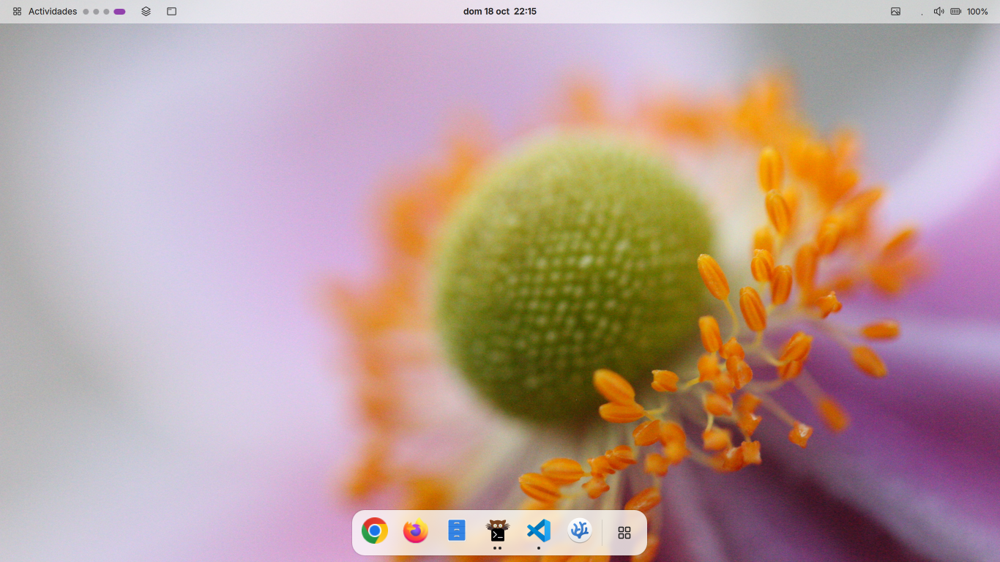
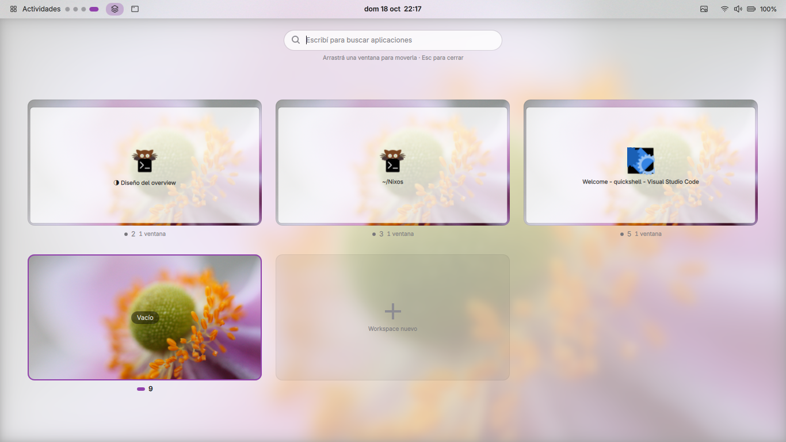
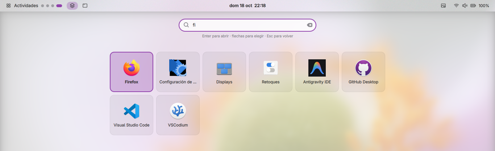
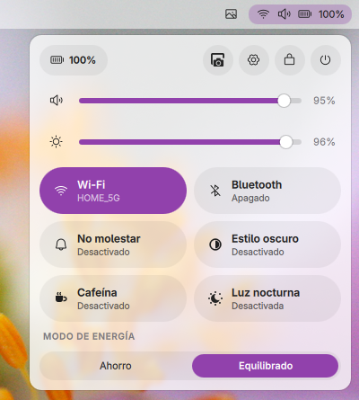
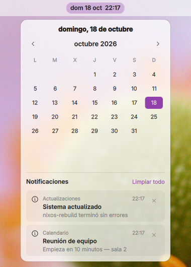
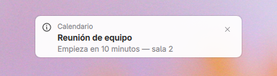
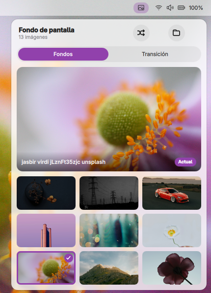
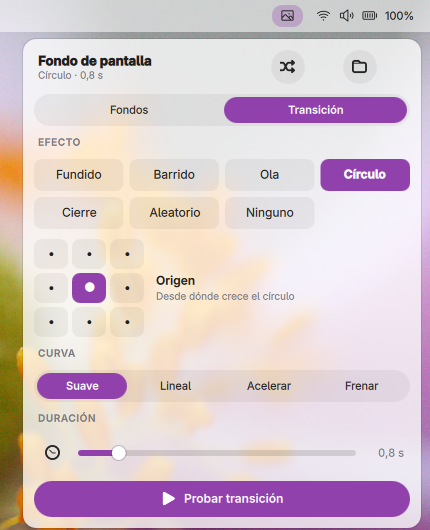
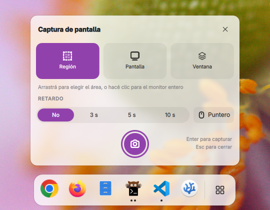
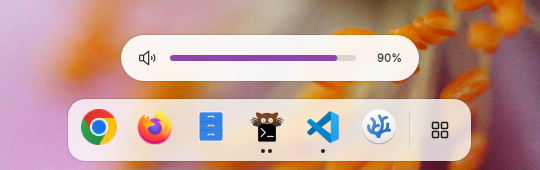

# QuickShell Config

A GNOME‑inspired desktop shell for **Hyprland**, built with
[Quickshell](https://quickshell.outfoxxed.me). Translucent Adwaita surfaces,
symbolic icons, the system accent color and live light/dark switching — with
the parts GNOME users expect: an overview with app search, quick settings,
a dock, OSDs, notifications and a screenshot UI.

The interface is in Spanish.



## Features

### Overview and app search

A mosaic of every workspace over the blurred wallpaper, with each window drawn
at its real position. Click a window to focus it, click a card to switch
workspace, or drag a window onto another card (or onto **Workspace nuevo**) to
move it. Start typing to search applications; <kbd>Enter</kbd> launches the
selected one.




### Quick settings

Wi‑Fi, Bluetooth, Do Not Disturb, dark style, Caffeine (idle inhibitor) and
night light toggles; volume and brightness sliders with an audio output
picker; power mode (power saver / balanced / performance); battery, settings,
lock, power menu and screenshot. Controls whose backing tool is missing are
shown disabled, with a hint, instead of hidden.



### Calendar, notifications and media

Clicking the clock opens the calendar with the notification history and an
MPRIS media card (artwork, title, artist and controls; it appears while
something is playing). The shell is its own notification server, with toasts
at the top of the screen.




### Dock

Pinned apps first, then running apps that aren't pinned, plus a button that
opens the overview. Dots show open windows (the focused app gets an accent
pill). Click to launch or focus (it cycles through windows when an app has
several), middle‑click for a new window, right‑click for a menu (window list,
new window, pin/unpin, close). It auto‑hides — reveal it at the bottom edge —
and stays visible on empty workspaces.

### Wallpaper picker and transitions

Large preview, a scrollable grid from `~/Pictures/Wallpapers`, and shuffle.
The **Transición** tab configures the [awww](https://github.com/LGFae/awww)
transition: effect (fade, wipe, wave, circle, close, random, none), direction
or origin, easing curve and duration, with a button to preview it on the
current wallpaper.




### Screenshot panel

GNOME‑style capture panel: region, screen or window mode, delay (none / 3 /
5 / 10 s) and whether to include the pointer. In region mode a click without
dragging captures the whole monitor. Captures are saved to
`$XDG_PICTURES_DIR/Capturas`, copied to the clipboard and announced with a
notification.



### Volume and brightness OSD

A pill above the dock whenever volume or brightness changes — from media
keys, `wpctl`/`brightnessctl` or any other app, since it watches the real
values (PipeWire and sysfs). Above 100 % volume the scale extends to 150 %
with a marker at 100 %.



### Also included

- **Window manager popup** for the active window: float, pin, pseudo‑tile,
  monocle, fullscreen, close, move to workspace, and a helper for Hyprland's
  dwindle layout (preselect split, orientation, swap).
- **Alt+Tab** window switcher (most recently used) and **Super+Tab**
  workspace switcher.
- **System tray** and a status pill (network, volume, battery).
- **Theme** that follows `org.gnome.desktop.interface` `color-scheme` and
  `accent-color` live through gsettings.

## Requirements

- [Quickshell](https://quickshell.outfoxxed.me) **0.3**
- **Hyprland with the Lua config.** Every dispatch uses the Lua API
  (`hl.dsp.focus({ workspace = 2 })`); it won't work with the classic
  `hyprland.conf` dispatcher syntax.
- PipeWire with `wpctl`, `brightnessctl`, `gsettings` + `gsettings-desktop-schemas`
- [`awww`](https://github.com/LGFae/awww) for wallpapers
- `grim`, `slurp`, `wl-clipboard`, `jq` and `notify-send` for screenshots
- Optional: `hyprsunset` (night light), `power-profiles-daemon` (power mode),
  UPower (battery), BlueZ (Bluetooth), NetworkManager (Wi‑Fi)
- Fonts and icons: Adwaita Sans, and the Phosphor icon theme (falls back to Adwaita)

## Install

Symlink or copy the repo to `~/.config/quickshell` and start it:

```bash
ln -s /path/to/this/repo ~/.config/quickshell
qs
```

To develop with live reload, run it straight from the clone:
`qs -p /path/to/this/repo`.

### Things to watch out for

- **Only one notification daemon.** If mako, dunst or swaync is installed and
  D‑Bus‑activatable, it can take `org.freedesktop.Notifications` before the
  shell does; toasts and history then stay empty, and the log shows
  `Could not register notification server`.
- **gsettings schemas under systemd.** When the shell runs as a systemd user
  service, `XDG_DATA_DIRS` may not include the GNOME schemas, and gsettings
  fails with `No schemas installed`: the dark style toggle does nothing and the
  theme stops following the system. Set `GSETTINGS_SCHEMA_DIR` for the service
  (on NixOS:
  `${pkgs.gsettings-desktop-schemas}/share/gsettings-schemas/${pkgs.gsettings-desktop-schemas.name}/glib-2.0/schemas`).
- **Blur** comes from Hyprland layer rules on these namespaces:
  `quickshell:bar`, `quickshell:toast`, `quickshell:popup:.*` and
  `quickshell:dismiss`.

## Keybindings (IPC)

The shell exposes IPC targets for Hyprland binds:

| Command | Action |
|---|---|
| `qs ipc call overview toggle` | Open/close the overview (also `open`, `close`) |
| `qs ipc call screenshot toggle` | Open/close the screenshot panel |
| `qs ipc call winswitch next\|prev\|confirm\|cancel` | Alt+Tab switcher |
| `qs ipc call wsswitch next\|prev\|confirm\|cancel` | Super+Tab switcher |

Example with the Lua config:

```lua
hl.bind("SUPER + D", hl.dsp.exec_cmd("qs ipc call overview toggle"))
hl.bind("Print", hl.dsp.exec_cmd("qs ipc call screenshot toggle"))
```

## State

Preferences are stored in `$XDG_STATE_HOME/quickshell/` (usually
`~/.local/state/quickshell/`):

| File | Contents |
|---|---|
| `wallpaper` | Current wallpaper, re‑applied on startup |
| `wallpaper-transition.json` | Transition effect, direction/origin, curve and duration |
| `dock-pinned.json` | Pinned apps (`.desktop` ids, in order) |

## Structure

```
shell.qml             Entry point: one Bar per screen
qmldir                Module definition (singletons)
Theme.qml             Colors, fonts and layout tokens; follows gsettings live
PopupManager.qml      Which popup is open; overview/screenshot IPC
Notifications.qml     Notification server + history
Switcher.qml          Alt+Tab / Super+Tab state and IPC
Wallpaper.qml         awww wallpaper + transition settings
Osd.qml               Volume/brightness OSD state
DockPins.qml          Pinned dock apps
Caffeine.qml          Idle inhibitor state
components/
  Bar.qml             Top bar; hosts every popup, dock and OSD
  OverviewPopup.qml   Workspace overview + app search
  QuickSettingsPanel.qml
  CalendarPopup.qml   Calendar, notifications, MediaPlayer
  Dock.qml            Dock (DockItem, DockMenu)
  WallpaperPopup.qml  Wallpaper picker + transition tab
  ScreenshotPopup.qml Screenshot panel
  OsdPopup.qml        Volume/brightness pill
  …                   Shared controls: PopupCard, QuickToggle, SliderRow,
                      SegmentedControl, ChipButton, TileButton, ActionRow…
```

## Customization

`Theme.qml` holds every token:

- `barAlpha` / `popupAlpha`: how much of Hyprland's blur shows through
- `barHeight`, `radius`, `iconSize`, `fontFamily`

The accent color and light/dark scheme come from the system (GNOME
Settings, or `gsettings set org.gnome.desktop.interface accent-color purple`).

## Design

New pieces follow [`DESIGN.md`](DESIGN.md) (in Spanish): tokens, components,
states, motion, icons and copy guidelines. The reference is GNOME Shell 46+
on a 1366×768 screen.
